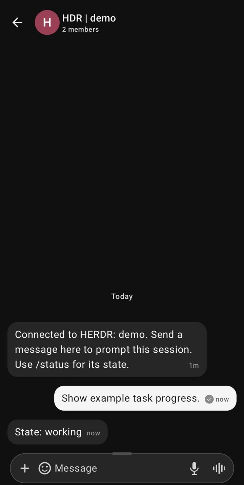
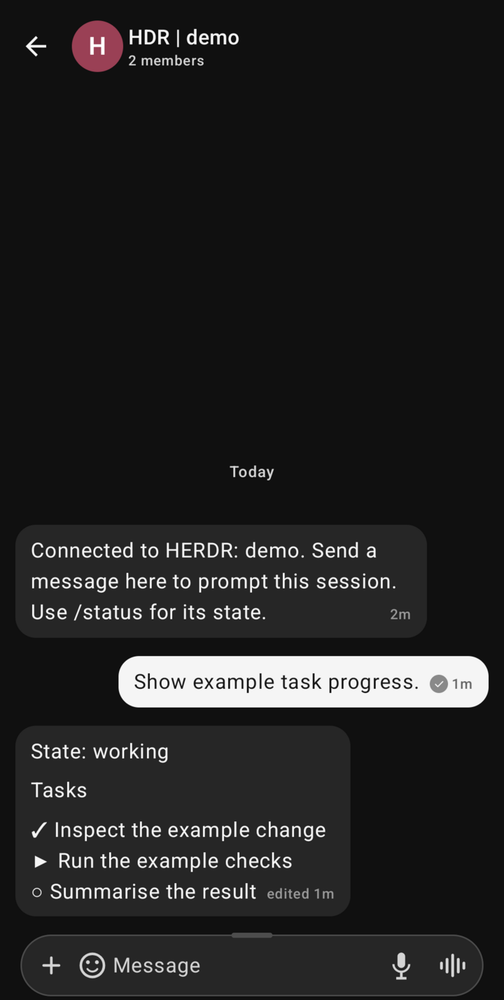
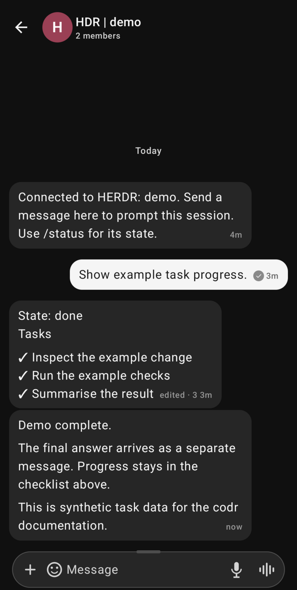
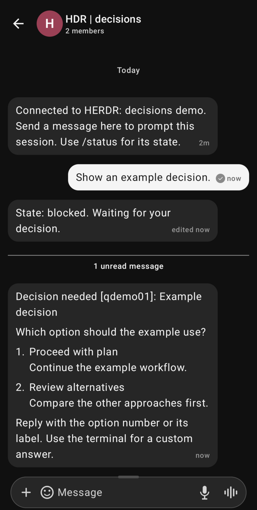
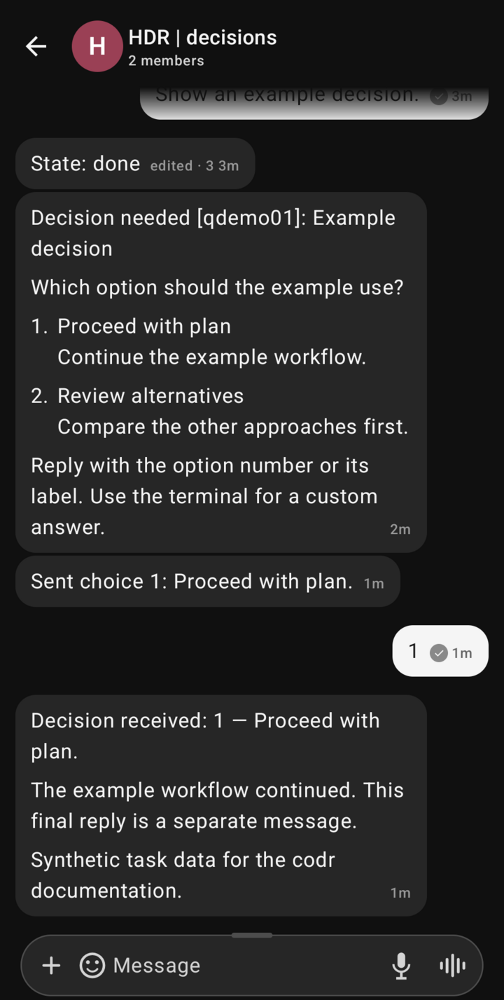

# HERDR White Noise Remote

A Linux [HERDR](https://github.com/herdrdev/herdr) plugin with one encrypted White Noise group per local agent session.

The plugin uses the maintained [Marmot Development Kit (MDK)](https://github.com/marmot-protocol/mdk) `wn-agent` transport. One dedicated bridge identity joins every group. Your phone uses White Noise for [iOS](https://github.com/marmot-protocol/whitenoise-ios) or [Android](https://github.com/marmot-protocol/whitenoise-android).

The current release runs on Linux, with structured final replies supported for OpenCode, Codex, and Claude Code.

## Desktop and phone

Keep the conversation in HERDR and follow it from White Noise. Each session has its own phone chat, named after its HERDR tab.

These side-by-side composites show real HERDR, OpenCode 1.19.3, and Android interfaces. The desktop replays matching synthetic history imported into an isolated OpenCode installation. The phone messages came through the real codr bridge and MDK transport using a synthetic HERDR/OpenCode fixture and a dedicated demo profile. These are documentation examples, not live model runs or end-to-end tests of a live decision dialog.

**Task progress and a separate final reply**


<details>
<summary>More conversations: decisions, review, and the chat list</summary>

**A decision and its phone reply**


**A separate review conversation**


**Three sessions, three phone chats**


</details>

## On the phone

Send a request from White Noise. The bridge posts a working message, edits that message with the task list, and sends the final answer separately.

| Working | Updated checklist | Separate final reply |
| :---: | :---: | :---: |
|  |  |  |

Captured from White Noise on Android with a dedicated demo profile. A synthetic HERDR/OpenCode fixture supplies the agent data; the app, encrypted transport, and bridge are real. Android status and navigation bars are cropped.

These captures use optional [editable progress](#editable-progress-and-separate-final-replies) with an MDK build that supports edits. Global mute controls and remote decisions are included in v0.4.0.

## Install with a coding agent

Copy this prompt into your coding agent. Replace `npub1…` with **your own White Noise public key**:

> Install https://github.com/tidley/codr on this machine. My White Noise public key is npub1…. Follow the agent installation guide and report what you verified.

The [agent installation guide](docs/INSTALL.md#instructions-for-coding-agents) covers discovery, installation, existing configurations, and verification.

The session groups and their connection/status messages show installation progress in White Noise. A separate completion message is optional.

For manual installation, follow the [human installation guide](docs/INSTALL.md#install-through-herdr).

## Behaviour

- New sessions create groups and invite the configured phone `npub`.
- Group names use the HERDR tab label: `HDR | <tab name>`, for example `HDR | review`. Repository names and agent-generated conversation topics do not determine the chat name.
- A phone message prompts only the agent mapped to that group.
- Replies come from completed stored agent messages. The bridge does not send reasoning or tool output.
- Working, idle, blocked, and ended notices appear in the group. A blocked notice includes a labelled terminal excerpt. Separate `done` notices are suppressed; the final reply signals completion.
- `/status` reports the mapped session state.
- Ended sessions retain their group. A restored native session reuses its group.
- Attachments and terminal key commands are not supported.
- Other detected agent backends get groups, prompts, and state notices. Structured final-reply extraction supports **OpenCode, Codex, and Claude Code**.

HERDR snapshots refresh every three seconds. Very short intermediate states can occur between snapshots. Native session references preserve routing across pane moves. Group creation waits for HERDR to report a native session reference. During identity uncertainty, the bridge defers prompts and preserves the existing group.

### At desk / Away forwarding

Use the HERDR action **White Noise forwarding: At desk / Away** to open the control popup. **Toggle White Noise forwarding** switches modes directly and can be bound to a HERDR shortcut.

HERDR 0.9.1 does not list plugin actions in its main click menu. For quick access, add this to your HERDR configuration:

```toml
[[keys.command]]
key = "prefix+f"
type = "plugin_action"
command = "local.white-noise.forwarding"
description = "White Noise: At desk / Away"
```

With the default prefix, press **Ctrl+B**, release it, then press **f** without Shift. The shortcut also appears in **Keybinds** under **White Noise: At desk / Away**. HERDR reloads configuration changes live.

The plugin opens this popup once when a fresh HERDR server starts after session restore. Reattaching to an existing server does not run the startup hook again; use the shortcut. Starting the bridge manually does not open another popup.

- **At desk:** suppress outgoing messages and new group invitations while the bridge continues to listen for your phone.
- **Away:** forward progress and final replies from every mapped session.
- A new message from the configured phone to any mapped group switches **all sessions** to Away. Already processed messages, your bridge's own messages, and other senders do not switch modes.

In the popup, enter **1** for At desk, **2** for Away, **3** to toggle, or **q** to close. Press Enter after your choice. Muting applies to every mapped session; it does not stop the transport or change your groups.

The selected mode survives restarts. Mode changes discard the outgoing backlog. Before Away becomes active, the bridge checkpoints replies for all active sessions. The popup shows **Away requested** while a transcript checkpoint is pending. Completed muted turns remain suppressed even if their transcript records arrive late. An operation already submitted to MDK can still arrive after you select At desk.

The command-line controls work while the worker runs:

```sh
~/.local/bin/herdr-white-noise-bridge forwarding status
~/.local/bin/herdr-white-noise-bridge forwarding desk
~/.local/bin/herdr-white-noise-bridge forwarding away
~/.local/bin/herdr-white-noise-bridge forwarding toggle
```

Forwarding defaults to Away on an existing installation. The control file is private and separate from routing state, so changing modes does not stop either service.

### Editable progress and separate final replies

Set `edit_responses = true` in the bridge configuration to enable editable progress. This requires an MDK build with the `edit_message` API, such as upstream commit `1d2b40dbd9bea1f7e9beb4ecab04482647a9e5a6`. The published `wn-agent` 0.13.0 binaries do not include that API. With those binaries, leave this mode disabled.

Each response starts as one `State: working` progress message. The bridge edits that message with the current task list, when available. It sends the final answer as a separate message through the normal durable send path, with its own retry key. The bridge never edits that final answer. When possible, it marks the progress message `State: done`.

OpenCode to-do writes, Codex plan updates, and Claude Code to-do/task tools supply structured task data. The bridge does not prompt a model to obtain progress. Message IDs and pending updates survive bridge restarts. Updates coalesce between snapshots, and edit attempts are at least two timestamp seconds apart.

Progress is best effort. Final replies take priority over progress updates, and progress requests have a three-second local deadline. A failed progress edit does not block a queued final answer. An MDK response or local readback does not prove phone delivery. Very long final replies use continuation messages to preserve all text. Progress messages are ordinary encrypted chat messages, not Nostr ephemeral events.

If HERDR becomes idle before the agent stores its final reply, the bridge keeps that response pending and retries the transcript read. After inspection, `clear-prompt` can release a cancelled response that has no final record.

The installer preserves the pinned MDK transport. Editable progress needs a separately installed MDK build with edit support; ordinary progress, decisions, and final replies work without it.

### Answer decisions from the phone

When OpenCode asks one single-choice question, codr sends a clean question card with numbered options. Reply with **1**, **2**, or an exact option label. The answer goes to the active question, even while HERDR reports the agent as blocked; it is not submitted as a new chat prompt.

| Decision waiting | Choice received and workflow continued |
| :---: | :---: |
|  |  |

Actual Android captures using a synthetic HERDR/OpenCode fixture with the real codr bridge, MDK transport, and Android app. The phone's **1** selected the first option and continued the fixture workflow; this does not verify a live OpenCode dialog end to end. Decision cards and answers do not require editable progress.

The bridge checks the session, pending tool request, and visible question before sending the native number shortcut. If a question was not answered through codr and is replaced, the new card requires its short code, for example `qabc123 1`. Duplicate deliveries and uncertain submissions are not sent again automatically.

This targets OpenCode 1.18.35's single-choice question UI. Custom text entry, multi-select/multi-question dialogs, permission approvals, and decisions in other backends require the terminal. Unsupported OpenCode blockers show a short notice instead of forwarding unrelated tool output.

HERDR 0.9.1 cannot make the final identity check and terminal input atomic. Avoid answering the same question simultaneously from the terminal and phone. After an uncertain answer, inspect the terminal before using `clear-prompt` and sending a new reply.

## Supported reply sources

| Agent | Final-reply source | Default transcript location |
| --- | --- | --- |
| OpenCode | Completed text from `opencode --pure export SESSION_ID` | Managed by OpenCode |
| Codex | Successful `task_complete` / `turn_complete` events with a turn ID and final message | `~/.codex/sessions` and `~/.codex/archived_sessions` |
| Claude Code | Completed main-conversation assistant responses with `message.stop_reason = "end_turn"` | `~/.claude/projects/<project>/<session-id>.jsonl` |

The bridge reads the existing session. It does not start another model invocation, change authentication, or use terminal snapshots as final replies. HERDR must report the native session ID.

Codex and Claude Code readers verify session identity, ignore partial records, and reject ambiguous transcript files. Claude's null stop reasons and duration markers alone are not treated as successful replies. Transcript formats are internal to the agent tools; unsupported or incomplete records are not guessed into final answers.

For custom profiles, set absolute `codex_home` and `claude_home` paths in the bridge configuration. Defaults use `CODEX_HOME` / `CLAUDE_CONFIG_DIR` when available, otherwise the locations above. Fresh setup records these paths explicitly.

Existing history is baselined when a group is first attached or reply support is first enabled for an older group. It is not reposted. Later completed replies use persistent message IDs to avoid duplicates after restart.

## To-do

- [x] Add structured final replies for existing Codex sessions.
- [x] Add structured final replies for existing Claude Code sessions.
- [ ] Add structured final replies for further HERDR-supported agents.
- [ ] Create new agent conversations from White Noise by messaging the main worker, which starts a HERDR session and creates its mapped group.
  - Select the HERDR workspace, directory, agent, and model.
- [ ] Allow multiple people to collaborate with the same agent and repository in a White Noise group.
  - Add owner-managed prompt permissions per group, including revocation.
  - Distinguish agent-directed requests from discussion between participants.
- [ ] Support White Noise voice messages and audio attachments, transcribing them locally into text prompts before forwarding them to an agent.
  - Review the existing Rust audio preprocessing and configurable transcription pipeline in [Nostr Codex Phone](https://github.com/tidley/nostr-codex-phone/blob/main/rust/src/transcribe.rs), which already supports whisper.cpp.
  - Evaluate [whisper.cpp](https://github.com/ggml-org/whisper.cpp) and Phonon-2, as used in [Phonon Wayland Dictation](https://github.com/tidley/phonon-wayland-dictation).

## Requirements

- Linux x86_64 or aarch64 with a systemd user manager.
- Python 3.11 or newer and Git. Rust is only needed when building from source.
- HERDR 0.9.1 or newer, with a running local server.
- MDK `wn-agent` 0.13.0, including `group_create` and `timeline_list` in `marmot.agent-control.v2`.
- A supported agent: OpenCode, Codex, or Claude Code. OpenCode needs `--pure export SESSION_ID`; Codex and Claude Code need readable native transcripts.
- HERDR native session references for the agents you want to control.
- Your phone must publish a compatible Marmot KeyPackage. The phone and bridge need reachable relays.

The repository does not implement MLS or Nostr cryptography. MDK owns keys, encrypted group state, relay connections, invitations, and delivery.

## Build

Build with Cargo:

```sh
cargo test --locked --tests
cargo clippy --locked --all-targets -- -D warnings
cargo build --locked --release
```

`Cargo.lock` is committed because codr is an application. It pins the dependency versions used by the build and installation commands.

## Install

Use the [installation guide](docs/INSTALL.md) for complete commands, including the pinned MDK download and checksum verification.

Install a pinned release through HERDR, then open its guided setup tab:

```sh
herdr plugin install tidley/codr --ref v0.4.0
herdr plugin action invoke local.white-noise.setup
```

The installation hook downloads and verifies the matching codr binary from GitHub Releases. Setup asks for your public `npub`, installs or reuses the pinned MDK transport, and configures dedicated user services. No Rust toolchain is required for this path.

For a non-interactive installation by a coding agent, see the [agent instructions](docs/INSTALL.md#instructions-for-coding-agents).

HERDR starts the plugin worker through its startup hook after restore. The worker's user service keeps it alive across client disconnects. Use `systemctl --user enable herdr-white-noise-bridge.service` if it must start independently at login.

Do not share the existing `wn-opencode` connector home. That adapter can also answer messages sent to its identity.

## GitHub builds

GitHub Actions runs Rust formatting, tests, Clippy, and isolated installer/setup tests on pushes and pull requests. A version tag builds native Linux x86_64 and aarch64 binaries with musl, then publishes archives and SHA-256 checksums to [GitHub Releases](https://github.com/tidley/codr/releases).

The installer selects the release version from the plugin checkout. It never silently substitutes a newer release. MDK uses its own pinned upstream release rather than a rebuilt or copied transport implementation.

## Verify on the phone

1. Accept an invitation from the verified bridge identity.
2. Send `/status` and check that it identifies a connected session.
3. Send a harmless request with a fresh word. Ask for that word without tools or file changes.
4. Check that the matching HERDR session receives the prompt.
5. Check that its completed reply returns to the same White Noise group.

A relay acknowledgement proves publication, not that the phone displayed or accepted a message. Phone verification requires the round trip above.

## Recovery and diagnostics

```sh
~/.local/bin/herdr-white-noise-bridge status
journalctl --user -u herdr-white-noise-bridge.service
```

State and the pending outbox use owner-only files. Keep them on persistent storage, with the MDK account home. Do not put these files in Git.

The bridge saves consumed phone-message IDs before it submits terminal input. It never retries an uncertain prompt automatically. This favours avoiding duplicate actions over automatic replay after a crash.

If a prompt result remains uncertain, inspect the live session first. Stop the worker and release the pending flag without resubmitting:

```sh
systemctl --user stop herdr-white-noise-bridge.service
~/.local/bin/herdr-white-noise-bridge clear-prompt 'SESSION_KEY_FROM_STATUS'
systemctl --user start herdr-white-noise-bridge.service
```

Group creation has no idempotency key in MDK 0.13.0. Connection failures before submission retry automatically. A timeout or ambiguous connector error requires inspection, including a missing KeyPackage error that MDK reports only as `app_error`.

After inspection, stop the worker. Bind the existing group or explicitly permit another creation attempt:

```sh
~/.local/bin/herdr-white-noise-bridge resolve-create 'SESSION_KEY_FROM_STATUS' --group GROUP_HEX
# Use --retry only after confirming that the previous attempt created no group.
~/.local/bin/herdr-white-noise-bridge resolve-create 'SESSION_KEY_FROM_STATUS' --retry
```

Then start the worker again. Failed sends retain their private outbox entries. Other groups continue after a group-specific send failure.

Offline recovery scans retained group history every minute and after reconnect. It uses existing rows as pagination cursors and durable message IDs for deduplication. Sender timestamps do not control eligibility. This also recovers late relay deliveries and messages from a phone with a different clock.

MDK truncates long timeline text to 8,192 characters. The bridge rejects truncated recovered prompts and asks for a shorter message.

### HERDR input limitation

HERDR 0.9.1 does not accept an expected native-session ID in `agent.prompt`. The bridge verifies the current terminal and session immediately before submission. A concurrent session replacement between verification and submission remains a server-API race. Avoid replacing an agent while sending a phone prompt. Atomic protection requires an upstream expected-session guard.

## Completion notice

To update existing group names without changing their session mappings, stop the worker and run:

```sh
~/.local/bin/herdr-white-noise-bridge rename-groups
```

Then start the worker again. This refreshes existing titles from current HERDR tab labels. Ended sessions without a stored tab label retain their existing title.

Tab renames do not automatically rewrite White Noise titles; run `rename-groups` to apply them. Sessions in tabs with identical labels can share a display name, while their routing remains separate.

Stop the worker before using its state-changing CLI. To send a notice to one mapped group:

```sh
~/.local/bin/herdr-white-noise-bridge notify --group GROUP_HEX 'The bridge is ready.'
```

Without `--group`, the command sends the notice to every mapped group. The command returns success only after MDK confirms publication.

## Acknowledgements

codr builds on the work of these projects and their maintainers and contributors:

- White Noise: the mobile messaging application used as codr's phone interface, maintained in the [iOS](https://github.com/marmot-protocol/whitenoise-ios) and [Android](https://github.com/marmot-protocol/whitenoise-android) repositories.
- [Marmot Development Kit (MDK)](https://github.com/marmot-protocol/mdk): the `wn-agent` connector that provides identity management, encrypted group state, relay transport, invitations, and message delivery.
- [Marmot protocol](https://github.com/marmot-protocol/marmot): the end-to-end encrypted group messaging protocol built on MLS with Nostr identity.
- [HERDR](https://github.com/herdrdev/herdr): the agent runtime, plugin system, and local API that codr uses to discover and control sessions.
- [OpenCode](https://github.com/anomalyco/opencode): the coding-agent runtime whose stored final replies codr currently reads.
- [Codex](https://github.com/openai/codex): the coding-agent runtime and native rollout records used by codr's Codex reply reader.
- [Claude Code](https://github.com/anthropics/claude-code): the coding-agent runtime whose native session transcripts codr reads for completed main-conversation replies.

codr provides the routing bridge between these systems. The messaging protocol, encryption, transport, mobile app, and agent runtimes come from the upstream projects above.
