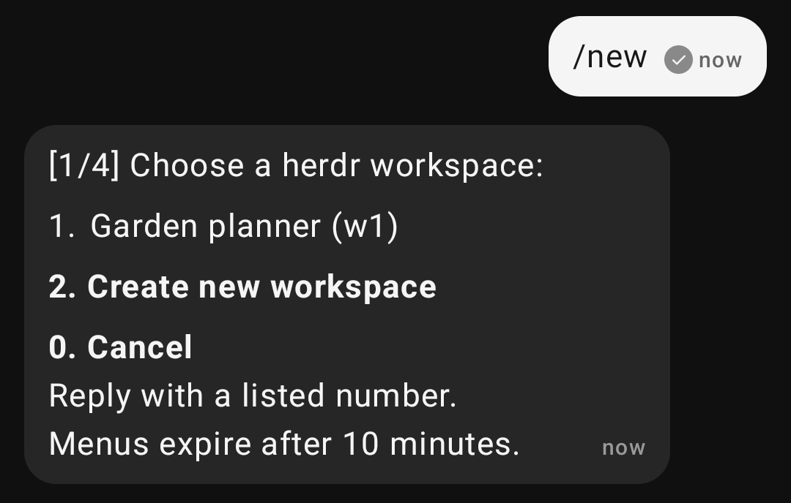
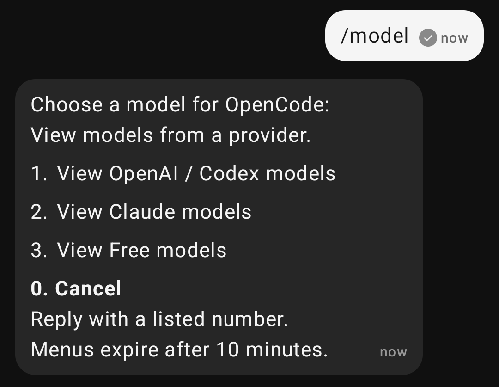
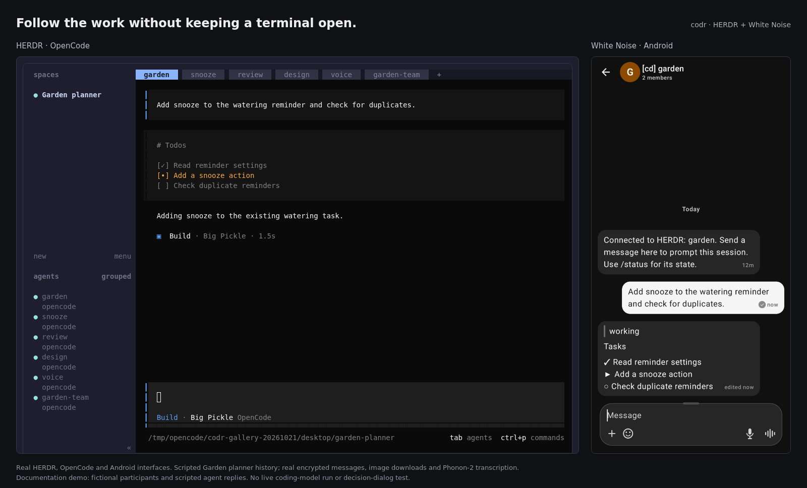
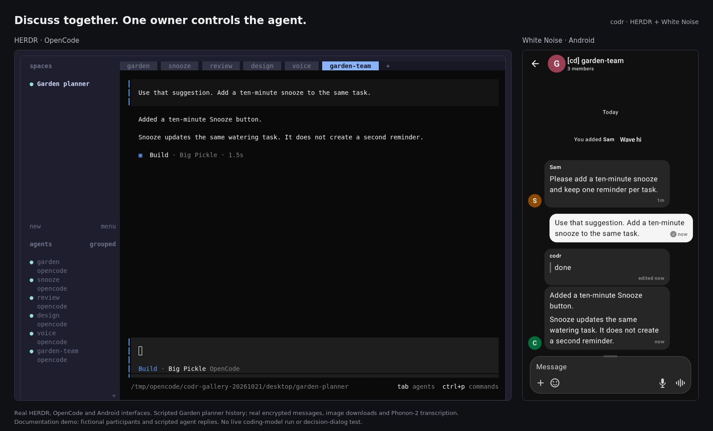
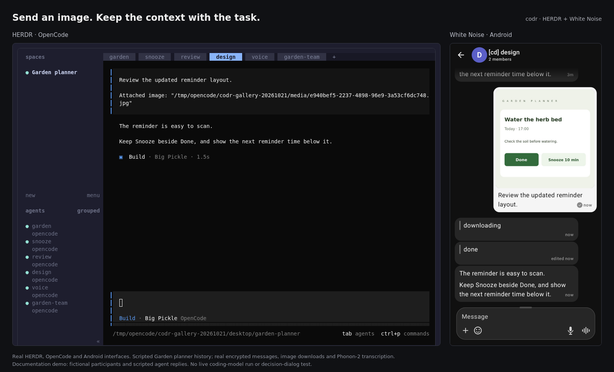
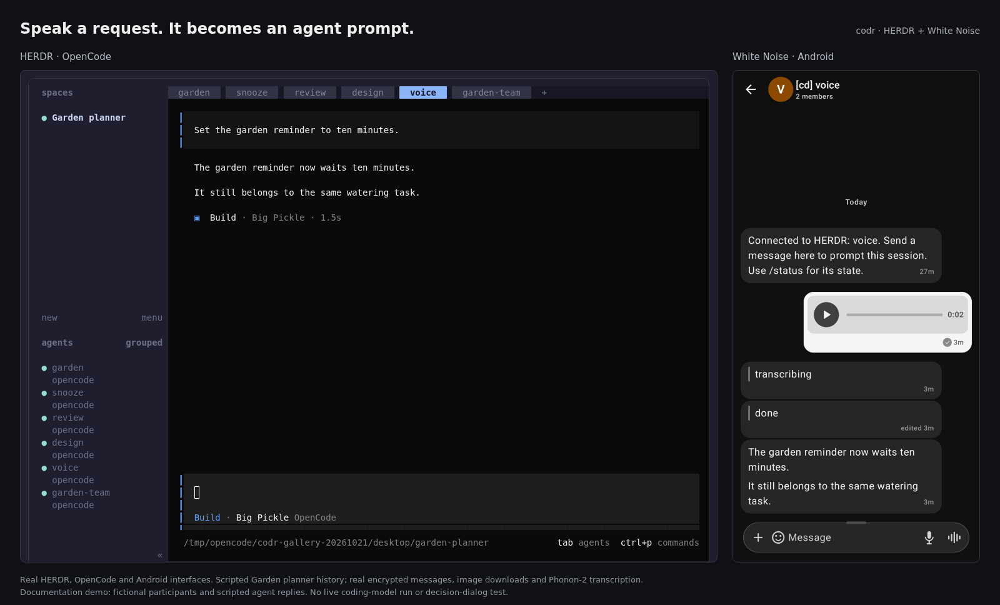
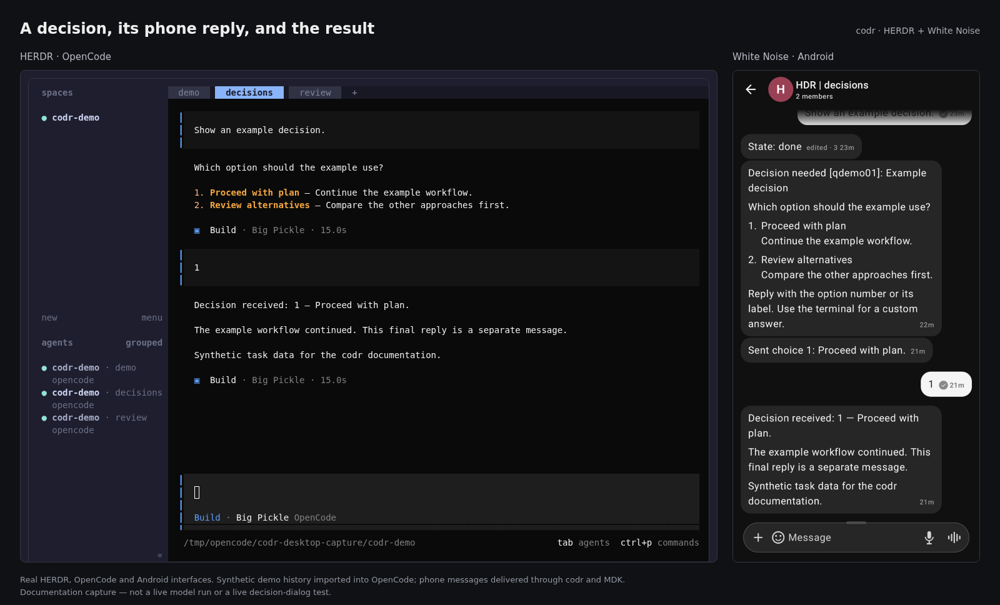
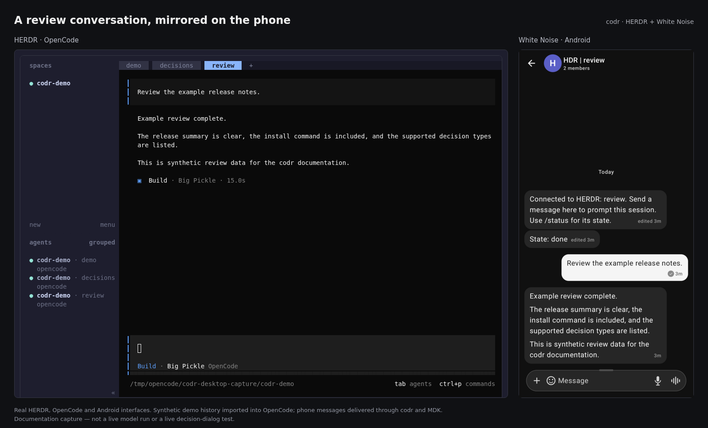
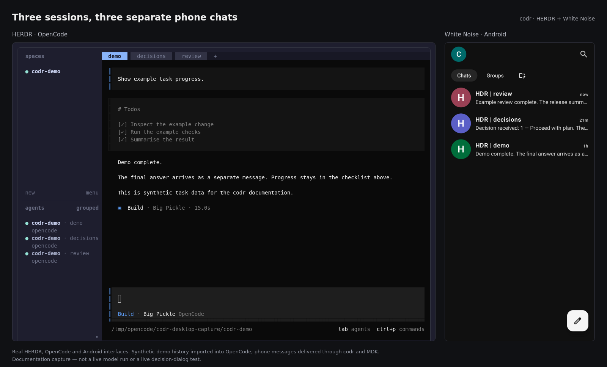

# **codr**

**codr** connects coding agent sessions in [**herdr**](https://github.com/herdrdev/herdr) to [White Noise](https://github.com/marmot-protocol/whitenoise-android), with one encrypted chat per session. Send a message from your phone to continue coding, create a project, choose an agent or model, and read the replies in the same chat.

Supported agents: OpenCode, Codex, and Claude Code on Linux and macOS.

New bridge accounts introduce themselves as **Pat**, your messenger between White Noise and herdr. Verify the full bridge public key printed by setup, not its display name.

The separate **portr** desktop app can optionally connect over SSH. Its codr endpoint is off by default; phone-only installs do not need it. [Optional desktop setup](docs/INSTALL.md#optional-portr-desktopssh-access)

## Behaviour

- Chat names pair the **herdr** tab and workspace: `review (Acme)`. Descriptions contain workspace and agent details.
- Status notices, optional editable checklists, and final replies appear as separate messages.
- Phone text is handed straight to the agent, including while it is working. The agent handles its own input; codr does not interrupt it or wait for idle. Send `/cancel` when you do want to interrupt the current task.
- `/new` guides you through workspace, folder, installed agent, and model selection. Reply with numbers, use `0` to cancel, and type the displayed workspace name to confirm the final preview.
- Choose the default model or browse a provider's full model list. OpenCode uses its authenticated model catalogue; variants are selected separately. `/agent` opens a separate chat without moving old history.
- Supported OpenCode questions accept a number or option label as a reply.
- New groups make your configured account an admin, so you can invite participants and rename the group. Only the owner can prompt the agent. [Group setup](docs/REFERENCE.md#shared-chats-and-owner-only-control)
- In automatic sync mode, local prompts mute all chats and an owner phone message resumes them. `/sync on` or `/sync off` keeps your explicit choice across restarts; `/unmute` restores automatic mode.

## Install

Needs Linux x86_64 or aarch64 or macOS on Apple silicon or Intel, a per-user service manager (systemd or launchd), Python 3.11+, Git, and **herdr** 0.9.1+. No Rust toolchain required.

```sh
herdr plugin install tidley/codr --ref v0.7.0
herdr plugin action invoke local.white-noise.setup
```

Enter **your White Noise public key** (`npub`) during setup. Get White Noise for [iOS](https://github.com/marmot-protocol/whitenoise-ios) or [Android](https://github.com/marmot-protocol/whitenoise-android).

Or give your coding agent this prompt, with your own public key:

> Install https://github.com/tidley/codr. My White Noise public key is npub1…. Follow docs/INSTALL.md and report what you verified.

[Full installation and upgrade guide →](docs/INSTALL.md)

## Usage

**Upgrading from 0.6.0 or an older MDK 0.13 installation?** 0.7.0 uses MDK 0.14. Before first opening that storage with the new connector, stop the services and keep a private, device-local backup of the complete connector home and secret-store credentials. The migration is one-way; downgrading to MDK 0.13 is unsupported. Setup refuses an automatic cross-cohort upgrade. Follow the [upgrade guide](docs/INSTALL.md) and [0.7.0 notes](docs/releases/0.7.0.md); do not bypass the backup gate. Existing MDK 0.14 installations retain their account and chat history.

1. Check the inviter against the bridge public key printed by setup, then accept the session's chat invitation.
2. Send `/status` to check the connection. Send a prompt to continue that session.
3. Read the reply in the same chat. For a supported decision, reply `1`, `2`, or an exact option label.

| Command | What it does |
| --- | --- |
| `/help` | Show commands and the current sync mode. |
| `/status` | Show connection, state and pending deliveries; resume sync in automatic mode. |
| `/recent` | Get the newest three text messages from each chat active in the past hour, skipping messages already delivered or pending. |
| `/new` | Set up a project, with a final name confirmation. |
| `/agent` | Choose an agent in a separate session and chat. |
| `/model` | Choose a model; OpenCode supports a confirmed idle-session change in place. |
| `/cancel` | Interrupt the current task, keeping chat history and accepted deliveries. |
| `/queue` | Inspect pending media and deliveries accepted before the update. |
| `/unmute` | Resume all chats and clear a forced sync mode. |
| `/sync auto\|on\|off` | Use automatic sync, always on, or always off. The choice persists across restarts. |

In 0.7.0, **`/recent` replaces the old catch-up `/sync` command**. It sends each eligible chat's excerpt to that chat, with **You** and **Agent** labels. Help and recent-message retrieval do not prompt agents or change sync mode.

New phone text does not join a worker-scheduled task queue. Messages are delivered without an interrupt; a backend can still use its own native inbox. A blocked permission or decision requires its supported answer or `/cancel`, not an arbitrary prompt. Media still needs download/transcription, and existing accepted deliveries are preserved across upgrades. `/clear-queue` is retired and does not discard those deliveries. A lost submission acknowledgement is never automatically retried.

Handoff is automatic. Manual controls remain available through **herdr**'s **White Noise forwarding: At desk / Away** action. [Controls and limits →](docs/REFERENCE.md#at-desk--away-forwarding)

## How it works

White Noise ↔ MDK ↔ **codr** ↔ **herdr** ↔ your agent

[MDK](https://github.com/marmot-protocol/mdk) handles identity, encrypted messaging, and relays. **codr** routes prompts through **herdr** and reads completed replies from existing agent transcripts.

Reply collection uses existing transcripts without an additional model call or terminal scraping. [Behaviour and recovery](docs/REFERENCE.md)

OpenCode can use incremental, read-only SQLite reads instead of full exports. [Reader configuration](docs/REFERENCE.md#incremental-opencode-database-reads)

**Limits:** Decision replies support OpenCode single-choice questions with 1–9 options. Other dialogs need the terminal. Avoid simultaneous terminal/phone answers. [Decision compatibility](docs/REFERENCE.md#answer-decisions-from-the-phone) · [Media and audio](docs/REFERENCE.md#images-and-voice-messages)

**Agent screenshots:** A new completed reply containing `` sends the image as an encrypted White Noise attachment. Files must be inside that session's working directory or `/tmp/opencode`. Ordinary links are not uploaded. Existing installations need the connector's private outbound-media spool enabled; see [outbound images](docs/REFERENCE.md#images-from-the-agent).

## Roadmap

[Planned work and completed items](docs/REFERENCE.md#roadmap).

## Features in action

Explore the fictional Garden planner project through real **herdr** and White Noise interfaces. Phone close-ups show real command replies in the stock Android app; click them for the full app view. Side-by-side demos use scripted agent replies, encrypted messages, and local speech-to-text. [Capture details](docs/REFERENCE.md#screenshot-provenance).

### Start a project

Send **`/new`** to choose an existing workspace or create one. Nothing starts before the final confirmation.

<a href="docs/screenshots/codr-v070-android-new-full.png"></a>

### Choose a model

Send **`/model`** in an idle OpenCode chat to browse providers. The current model stays unchanged until confirmation.

<a href="docs/screenshots/codr-v070-android-model-full.png"></a>

### Follow progress

Read working status and task progress in the session chat. Editable checklists require `edit_responses = true`.



### Share a project

Alex invited Sam to the Garden planner chat. Sam can discuss the project, but only Alex's messages reach the agent.



### Send an image

Attach a design from your phone so the agent can review the downloaded image.



### Send a voice message

Record a message on your phone; local speech-to-text turns it into an agent prompt.



### Answer a decision

Reply with a number to answer a supported OpenCode question without returning to the terminal.



### Read a review

Read the agent's review in the same chat, alongside the matching herdr session.



### Keep sessions separate

Each herdr session has its own chat. Group related chats in a White Noise project folder.



---

[Operating reference](docs/REFERENCE.md) · [Changelog](CHANGELOG.md) · [Releases](https://github.com/tidley/codr/releases)

Built on [**herdr**](https://github.com/herdrdev/herdr), [White Noise](https://github.com/marmot-protocol/whitenoise-android), [MDK](https://github.com/marmot-protocol/mdk), and the [Marmot protocol](https://github.com/marmot-protocol/marmot). [Full credits](docs/REFERENCE.md#acknowledgements).
